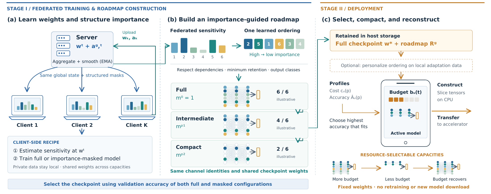

# RAS-FL

Code for resource-adaptive federated learning, structured model compaction, and deployment under changing resource budgets.



[Vector version of the figure](assets/framework.pdf)

## Experiments

All experiment groups support Fashion-MNIST, CIFAR-10, and CIFAR-100 at training Dirichlet concentrations **0.1 and 0.4**. The default seeds are **42, 123, and 2024**.

| Dataset | Architecture | Training clients | Unseen clients |
|---|---|---:|---:|
| Fashion-MNIST | Three convolutional blocks and an MLP head | 20 | 20 |
| CIFAR-10 | VGG-16 with batch normalization and a small-image head | 20 | 20 |
| CIFAR-100 | ResNet-18 with a small-image stem | 20 | 20 |

Methods: **FedAvg, FedProx, FedDropout-style, Slimmable-style, OFA-style, SLEX-style, FIARSE, FjORD, RAS-FL**, and **Personalized RAS-FL**. Personalized RAS-FL is evaluated from the same trained checkpoint.

| Group | Settings |
|---|---|
| Ablations | Random masks; with distillation; no shrinkage-aware training; full-model checkpoint selection |
| Importance EMA coefficient | 0.90, 0.95, 0.99 |
| Mask-training probability | 0.10, 0.25, 0.50 |
| Masked levels per minibatch | 1, 2, 4 |
| Full-model checkpoint-score weight | 0.25, 0.50, 0.75; weight 1.0 is the full-model selection ablation |
| Training level sets | {10,40}; {10,25,40}; {5,10,20,30,40}; {5,10,15,20,25,30,40} |
| Deployment controls | Adaptive selection and fixed full-model selection on the same memory trace |

The default sensitivity values reuse the main RAS-FL run. The level-set experiments use a fixed set after warmup; the main run uses the curriculum in `core/methods.py`.

## Installation

Use Python 3.10 or newer and a compatible PyTorch/torchvision pair. The supplied requirements pin the versions used for the local CPU checks.

```bash
python -m venv .venv
source .venv/bin/activate
python -m pip install -r requirements.txt
```

For CUDA training, install the matching CUDA builds of PyTorch and torchvision for the target machine. Dataset downloads are enabled only when `--download` is supplied.

## Run

Inspect the complete plan without loading datasets or training:

```bash
python reproduce.py --plan-only --device cuda --download --output results/paper
```

Run the same plan:

```bash
python reproduce.py --device cuda --download --output results/paper
```

The complete grid contains **450 training seed runs**, plus deployment evaluation. It runs sequentially. Use separate output directories for different subsets or settings.

Resume after an interruption:

```bash
python reproduce.py --device cuda --download --output results/paper --resume
```

Completed runs are skipped. Interrupted rounds restart from the last completed round. Configuration or source changes require a fresh output directory.

Run RAS-FL on one dataset and concentration:

```bash
python reproduce.py --datasets fashionmnist --alphas 0.1 \
  --sections main --methods rasfl --device cuda --download \
  --output results/fashionmnist_rasfl
```

Run the ablations and all sensitivity groups:

```bash
python reproduce.py --sections main ablations sensitivity levels \
  --device cuda --download --output results/controls
```

Run only the training-level sensitivity:

```bash
python reproduce.py --sections levels --device cuda --download \
  --output results/training_levels
```

Run FIARSE and FjORD:

```bash
python reproduce.py --sections baselines --device cuda --download \
  --output results/additional_baselines
```

A short synthetic check, requiring no downloads:

```bash
python reproduce.py --datasets fashionmnist --alphas 0.1 \
  --sections main --methods rasfl --smoke --device cpu \
  --output results/smoke
```

`--no-benchmark` skips hardware profiling and replay. `--no-dynamic` skips replay only. Synthetic outputs are isolated under `SMOKE_SYNTHETIC` and are not research results.

## Configuration and evaluation

Base configurations are in `core/configs/`. Each run saves its resolved configuration, data split, source hashes, history, and checkpoints. The launcher exposes `--rounds` and a single shared `--patience`; defaults are 500 rounds and patience 5 for every method, including RAS-FL and all ablation and sensitivity runs. Changing `--patience` applies the same value to every method. Historical results with different stopping settings require their corresponding configurations.

All training clients participate each round. SGD uses learning rate 0.01, momentum 0.9, weight decay 0.0005, batch size 64, and one local epoch. Training-client validation selects checkpoints. Deployment concentration is 0.08; local adaptation and test subsets are disjoint. Distillation is controlled by `kd_alpha` in the configuration; the distillation ablation sets it to 0.2 with temperature 2.

Accuracy is averaged equally over unseen clients within each seed. Reported uncertainty is the sample standard deviation across seed means. Single-seed summaries leave the standard deviation empty.

The full capacity sweep records 0, 5, 10, 15, 20, 25, 30, and 40% nominal removal. Capacity averages exclude the full model and use:

- Fashion-MNIST: 5, 10, 15, 20, 25, 30, 40%.
- CIFAR-10: 5, 10, 15, 20, 25, 30%.
- CIFAR-100: 5, 10, 15, 20%.

Nominal removal and active parameter percentage are different quantities. FLOPs count convolution and linear operations. Latency and memory measurements depend on the device. The dynamic trace is a declared synthetic memory-budget trace, with budgets covering model tensors rather than total process memory.

FIARSE and FjORD use independent protocol adaptations with fixed client-capacity tiers. The core methods do not use these tiers. Their algorithm notes and reference provenance are retained under `baselines/`; their active parameter counts should not be interpreted as measured memory or FLOP savings. The “-style” baselines are adaptations to the shared backbones.

## Additional controls

`posthoc_fedavg.py` builds an importance roadmap from a selected FedAvg checkpoint without updating its weights. `matched_budget.py` compares saved global models under predefined absolute parameter budgets. Both accept saved runs from all three datasets and both concentrations; run them with `--help` for the required checkpoint, split, and budget arguments.

The dynamic replay saves both `dynamic_requests.csv` (adaptive selection) and `dynamic_requests_fixed_0.csv` (fixed full model) for RAS-FL. The fixed policy leaves requests unserved when the full model does not fit. Both policies use the same checkpoint, examples, and budget trace.

## Results

```text
results/paper/
  experiment_plan.json
  alpha_0.1/
    core/                 # Runs, resolved configs, tables, figures, result archive
    baselines/            # FIARSE and FjORD, organized by dataset
  alpha_0.4/
  per_seed.csv
  summary.csv
```

Regenerate the top-level tables from saved results without training:

```bash
python summarize.py results/paper
```

The top-level tables include full accuracy, capacity-average accuracy, accuracy at 10/20/30/40%, balanced accuracy, test loss, checkpoint score, and selected round where recorded. Accuracy and score columns use percentages. Missing metrics remain empty. The core result bundles additionally include per-client predictions, compaction measurements, convergence curves, and LaTeX tables; their raw accuracy fields use fractions.

A summary may contain only completed runs. Check its run-count columns and each core bundle's `coverage.json` before reporting results. This release contains code and the framework figure, not pretrained checkpoints or newly reproduced full-training results.

## Checks

```bash
python check.py
```

Checks cover data splits, structured masks, compact-model equivalence, gradient handling, stopping/resume behavior, aggregation, experiment coverage, and baseline implementations. CUDA-specific checks are skipped when CUDA is unavailable. See `VALIDATION.md` for the checks performed on this release.
